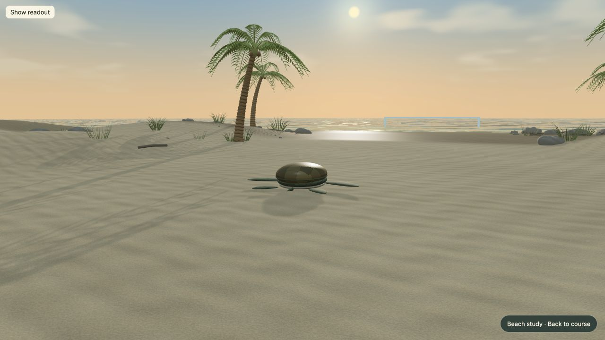
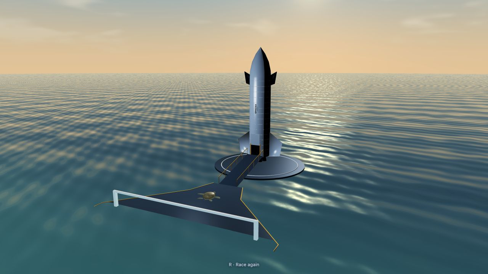

# baby-turtle-simulator-2
DubHacks 2026 Submission

Browser-based turtle racing prototype built with Babylon.js, TypeScript and Vite.

## Run locally

Install Node.js 22.12+ with npm. Open a terminal in your copy of this project
(the folder containing `package.json`). On this Mac:

```sh
cd /Users/leontruong/Downloads/Clones/baby-turtle-simulator-2
npm ci
npm run dev -- --host 127.0.0.1
```

Wait for `npm ci` to finish successfully before starting the server. Keep the
server terminal open while playing; press **Ctrl+C** in that terminal to stop it.
On another computer, replace the `cd` path with your project's location.

Open the **Local** URL printed by Vite, normally http://127.0.0.1:5173/.
Open
http://127.0.0.1:5173/?beachPreview=1 (or select **Explore the beach preview**)
for the tropical beach asset study. Both use the same movement and finish logic.

If port 5173 is already in use, choose another port:

```sh
npm run dev -- --host 127.0.0.1 --port 5175
```

Then open http://127.0.0.1:5175/ (add `?beachPreview=1` for the beach preview).

If installation reports an npm cache permission error (`EACCES`), use a temporary
cache on macOS/Linux:

```sh
npm ci --cache /tmp/baby-turtle-npm-cache
```

If the browser reports a missing module inside `node_modules/vite`, stop the
server and wait for any running install to finish. Run `npm ci` again (with the
temporary cache option above if needed), restart the server, and reload its
printed **Local** URL. Run only one dependency installation at a time.

- Select **Start race** or press Enter for a three-second countdown.
- W / Up: crawl in the camera's direction. S / Down: move the opposite way.
  A / D or Left / Right: move sideways relative to the camera.
- Space: brake. X: use the stored item-box ability. R: restart at the nest with a new countdown.
  H: show or hide the readout.
- Hold the right mouse button and drag to look around; the camera stays still while you crawl.
- Scroll to zoom. The beach preview starts facing the palms with the readout hidden;
  use H or **Show readout** for controls/status. The cinematic takes over at the finish.
- Xbox-compatible gamepad mapping remains available; press a controller button to expose it to the browser.

Both course views include the start screen, race timer, local practice rival, item boxes,
ability HUD and rematch. The preview contains natural dunes, five palms sharing geometry/materials, dune grass,
weathered stones and driftwood, fine sand and reflective wet sand. A procedural sky
adds clouds and a sunrise; the ocean has animated waves, shoreline foam, reflected
sky and sunlight. Both views now use your supplied Blender sea turtle, with its actual
painted skin/shell, eyes and eyelids. A weighted flipper rig keeps the mesh connected
while crawling and boarding. The head and eyes stretch forward for Snappy's neck and
snap move. Turtle types, health, specials, controls and race rules remain in place.

The pickups are original Mario Kart-style spinning question-mark cubes. Their
locations, random abilities, pickup radius and nine-second respawn are unchanged.
The existing seagull model now unfolds and flaps its wings while airborne, holds
them steadier during dives and folds them when perched or stunned.

The turtle is **Ocean Turtle by der_On, CC BY 3.0**, from `Ocean Turtle.zip`;
see [its original license and adaptation notes](public/credits/ocean-turtle.txt).
The original archive stays intact. Environment textures/sky and item-box art are
procedural; the bird retains its existing credits. No new packages, paid services
or API keys were introduced for these changes. These are browser-friendly raster effects,
not a reproduction of GTA V Enhanced's rendering system. Water animation is cosmetic:
it does not add swimming physics or change the finish coordinates.

The TMNT model, materials, tests and screenshots are preserved for future reference.
Open http://127.0.0.1:5173/?beachPreview=1&turtle=tmnt to view it.

To rebuild the sea-turtle assets with the free Blender already installed on this Mac:

```sh
/Applications/Blender.app/Contents/MacOS/Blender --background --factory-startup --disable-autoexec --python scripts/export_ocean_turtle.py
```

This is only needed after changing the source/converter. It preserves the original
UVs, uses subdivision level 1 and bakes the old object-space normal map into a
1024×1024 tangent-space map. Four meshes total 9,096 triangles per racer; textures
and native Babylon vertex data total about 2.67 MB before HTTP compression.
There is no separate turtle loader dependency or runtime Blender requirement.

For a close-up wing animation check, run the Vite dev server and open
http://127.0.0.1:5173/wing-preview.html. **Flying**, **Perched** and **Diving** use the
same bird model and wing rig as the race. This developer page is separate from the
production game entry point.



## Starship ending

Race through the pale gate in the ocean, then release the controls. In both course views:

1. Starship, its launch pad and a connected walkway rise from beneath the sea over 4.8 seconds.
2. The turtle waits for the walkway, then crawls across it and up the boarding ramp automatically.
3. The turtle folds its flippers, enters the hatch, and boards the ship.
4. A three-second countdown starts the engines, followed by liftoff.
5. The camera follows Starship into space, with Earth, clouds and stars below/behind it.

Movement, braking and look input do not drive the cinematic. **R** restarts from any
stage, including orbit, restoring the beach, turtle, normal camera and lighting.
The result screen appears after reaching space. Select **Rematch** or press Enter
to start the countdown again.
The sequence takes roughly 27 seconds after the finish and needs no further input.
The settled deck sits at y=0.42 above the highest wave (y=0.12). During the ending,
the horizon ocean replaces the race water/finish surfaces so they do not overlap.
The hatch is wide enough for the imported Leatherback model with its flippers folded.
There are no action descriptions or story captions; only the numeric countdown and
a small restart hint remain on screen.
The rocket, fictional boarding hatch, dock, exhaust and Earth are original procedural
artwork. There are no additional dependencies, downloaded models or paid services.



## Turtle types and their moves

Pick a turtle on the start or results screen. Power-ups use **X**; the turtle's own move uses **E** (keyboard) or **Y** (pad) and has a cooldown shown beside the item box.

| Type | Health | Speed | Power-up slots | Own move |
|---|---|---|---|---|
| Regular | 50 | x1 | 2 | none |
| Leatherback | 75 | x0.85 | 1 | **Body slam**, 18 s cooldown: surges about 6 m in a straight line with steering locked, stuns the rival for 2.2 s (and costs it 10 health) and stuns any low seagull it plows into. Debris cannot hurt it mid-slam. |
| Kempy | 35 | x1.2 | 1 | **Spin dash**, 8 s cooldown (same as the snap): 1.5 s of extra speed and spinning, during which every hit is ignored (debris, bumps, sand, snaps, seagulls) and Shell Guard charges are kept. |
| Snappy | 58 | x1 | 1 | **Snap**, 8 s cooldown: bites the rival or stuns gulls within reach. |

## Seagull

Four seagulls guard the course: two on the dry sand (z = -8 and 4), one on the wet sand (z = 18) and one near the shore (z = 30). The ones at z = 4 and z = 30 are fliers: they circle about 5.5 metres up, stalk the turtle from above, then dive at where it is when the dive starts (steer sideways to dodge), and climb away if they miss. A faint orange ring on the sand under each flier shows its dive range (stronger while it stalks), and a small marker appears where a dive will land. Walkers stay low and chase on the ground. Their spots are listed in `seagullSpawns`. Rules live in `src/mob/seagull.ts`, drawing in `src/mob/createSeagull.ts`.

- It stays put until you come within 10 metres, then chases at 90% of the regular turtle's top speed on the ground under it. It gives up and flies home if it ends up 18 metres from its perch.
- A touch costs 33% of the turtle's maximum health and knocks the turtle and the gull apart. Shell Guard stops the damage and the turtle's knock-back (the gull still bounces off).
- At 0 health the gull swoops in, grabs the turtle, carries it up to 22 metres back toward the nest (never past the back of the beach), sets it down, and the turtle gets 40% of its health back. The gull then ignores you for a few seconds. Controls are locked during the carry.
- Snappy's snap stuns any gull within reach (below 2.4 metres, so a gull circling high up is out of reach) for 2.5 seconds: it drops to the sand, is pushed back and cannot attack. A stunned gull also can't answer the rescue call, so a worn-out turtle waits until a gull recovers.
- The model is `public/models/seagull.glb`. It has no animation, so the gull glides rather than flapping.
- Loading it needs the official `@babylonjs/loaders` package (free, Apache-2.0, same version as Babylon core).

Credit: "Seagull" by Bwinji Shamutete (https://sketchfab.com/MangyMedusa), CC BY 4.0,
https://sketchfab.com/3d-models/seagull-dd79fddb754f47caa3145e7d184e3e58

## People throwing nets (local race)

Two beachgoers stand outside the course, on opposite sides. A nearby turtle makes
them wind up for 0.85 seconds, then throw a visible rope net along a 1.1-second arc.
The gold landing circle follows their aim until release, then stays fixed: move
sideways to dodge it. A landed net lasts 1.8 seconds and can catch each racer once.

A catch reduces speed and acceleration to 55% for 2.6 seconds. You can still steer
and crawl; the ropes and the amber status message disappear when the timer ends.
Nets take no health. Shell Guard consumes its charge to block a catch; Kempy's
active spin also blocks it. A short grace period prevents repeated catches from
immediately stacking. Both the player and the practice rival can be caught.

These humans and ropes are original procedural geometry with shared rope buffers,
merged body parts and no texture downloads or new dependencies. Nets freeze at the
finish, disappear during the rocket cutscene and reset on R/rematch. They are only
enabled in local races; the online server's existing race rules are unchanged.

To try it: run `npm run dev -- --host 127.0.0.1`, open the printed URL with
`?beachPreview=1`, and click **Start race**. Watch both sides as you approach the
middle of the beach. The default course also includes the hazard.

## Milestones

The merged prototype includes scene/input/movement/finish detection, local race flow,
Tide Orb pickups and ability implementations. The optional beach study previews
environment assets without marking the complete visual or performance milestones
finished. An online room can share the countdown, Tide Orbs, abilities and finish
order when the local multiplayer server is running. Deployment is still separate.
The practice rival is local.

## Automated checks and production preview

```sh
npm test
npm run build
npm run preview -- --host 127.0.0.1
```

Open http://127.0.0.1:4173/?beachPreview=1 to inspect the built preview.
Tests cover input, movement, finish detection, HUD formatting, palm/hatchling geometry
budgets and validity, animation compatibility and keeping dunes out of the playable lane.
The ending tests cover automatic paths from the left/center/right of the finish,
waiting for the platform to finish rising, boarding before launch, stage order,
continuous movement, restart state and frame-time guards.
They do not prove visual quality or physical controller behavior.

For manual browser checks: inspect the palm from both sides, crawl across dry sand,
wet sand and water into the pale finish gate, watch the platform rise and automatic
boarding/countdown/launch/orbit, use R during emergence or in orbit to reset, try mouse look and
scroll zoom, and follow **Back to course** to compare with the default scene.
Physical controller and slower-device performance testing remain manual checks.
The build currently reports Vite's large-chunk warning for the Babylon.js bundle;
it succeeds, but download size and performance on lower-end devices still need work.

See MODLOG.md for the asset recipe and verification record.
