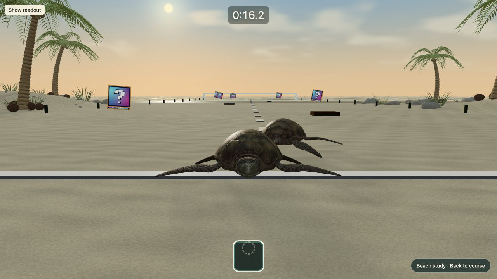

# baby-turtle-simulator-2
DubHacks 2026 Submission

Browser-based turtle racing prototype built with Babylon.js, TypeScript and Vite.

## Run locally

Use Node.js 22.12+ (verified here with 24.14.1). From a terminal:

```sh
cd /Users/leontruong/Downloads/Clones/baby-turtle-simulator-2
npm ci
npm run dev -- --host 127.0.0.1
```

Open http://127.0.0.1:5173/ for the existing course. Open
http://127.0.0.1:5173/?beachPreview=1 (or select **Explore the beach preview**)
for the tropical beach asset study. Both use the same movement and finish logic.

- Select **Start race** or press Enter for a three-second countdown.
- W / Up: crawl in the camera's direction. S / Down: move the opposite way.
  A / D or Left / Right: move sideways relative to the camera.
- Space: brake. X: use the stored item-box ability. R: restart at the nest with a new countdown.
  H: show or hide the readout.
- Hold the right mouse button and drag to look around; the camera stays still while you crawl.
- Scroll to zoom. The beach preview starts facing the palms with the readout hidden;
  use H or **Show readout** for controls/status. The cinematic takes over at the finish.
- Xbox-compatible gamepad mapping remains available; press a controller button to expose it to the browser.

Both course views include the start screen, race timer, local practice rival, item boxes,
ability HUD and rematch. The preview contains natural dunes, five palms sharing geometry/materials, dune grass,
weathered stones and driftwood, fine sand and reflective wet sand. Four fallen coconuts
sit beside each palm, outside the track. A procedural sky
adds clouds and a sunrise; the ocean has animated waves, shoreline foam, reflected
sky and sunlight. Both racers now use the sea turtle from your **Ocean Turtle.zip**:
the actual Blender mesh, painted skin/shell texture, eyes and eyelids. A weighted
four-flipper rig adapts the swimming pose into a low crawl and folds through the
rocket hatch. Movement, camera controls and abilities still use the same game logic.

The procedural TMNT model, its materials and screenshots are kept for future use.
Open http://127.0.0.1:5173/?beachPreview=1&turtle=tmnt to view that saved model.

The five pickups are Mario Kart–style spinning question-mark boxes with original
procedural artwork, shared geometry and a small texture. Their positions, random
abilities, pickup radius and nine-second respawn behavior are unchanged. Collect
one, then press **X** to activate the stored ability.

The turtle is **Ocean Turtle by der_On, CC BY 3.0**, from the supplied archive;
see [asset credits](public/credits/ocean-turtle.txt). Its conversion runs locally in
free Blender. Environment models, textures and sky reflections are created locally;
there are no new dependencies, paid services or API keys. These are browser-friendly raster effects,
not a reproduction of GTA V Enhanced's rendering system. Water animation is cosmetic:
it does not add swimming physics or change the finish coordinates.



To rebuild the converted asset (only needed after editing the archive/converter):

```sh
/Applications/Blender.app/Contents/MacOS/Blender --background --factory-startup --disable-autoexec --python scripts/export_ocean_turtle.py
```

Or use `blender` in place of the application path on machines where it is on PATH.
The converter reads the original archive, applies one subdivision level, converts
scale/axes, adds flipper skin weights and bakes the old object-space normal map to a
1024×1024 tangent-space map. It writes four meshes totaling 9,096 triangles and the
compressed color/eyelid textures. The game uses native Babylon vertex data, so it
does not need a separate model loader package.

## Starship ending

Race through the pale gate in the ocean, then release the controls. In both course views:

1. Starship, its launch pad and a connected walkway rise from beneath the sea over 4.8 seconds.
2. The turtle waits for the walkway, then crawls across it and up the boarding ramp automatically.
3. The turtle folds its flippers, enters the hatch, and boards the ship.
4. A three-second countdown starts the engines, followed by liftoff.
5. The camera follows Starship into space, with Earth, clouds and stars below/behind it.

Movement, braking and look input do not drive the cinematic. **R** restarts from any
stage, including orbit, restoring the beach, turtle, normal camera and lighting.
The result screen appears after reaching space. Select **Rematch** or press Enter
to start the countdown again.
The sequence takes roughly 27 seconds after the finish and needs no further input.
There are no action descriptions or story captions; only the numeric countdown and
a small restart hint remain on screen.
The settled walkway sits above the highest waves. Race water is replaced during the
cinematic to prevent overlapping water surfaces; restart restores the original scene.
The rocket, fictional boarding hatch, dock, exhaust and Earth are original procedural
artwork. There are no additional dependencies, downloaded models or paid services.


## Milestones

The merged prototype includes scene/input/movement/finish detection, local race flow,
Item-box pickups and ability implementations. The optional beach study previews
environment assets without marking the complete visual or performance milestones
finished. Multiplayer and deployment remain separate work; the rival is local.

## Automated checks and production preview

```sh
npm test
npm run build
npm run preview -- --host 127.0.0.1
```

Open http://127.0.0.1:4173/?beachPreview=1 to inspect the built preview.
Tests cover input, movement, finish detection, HUD formatting, character/palm geometry
budgets and validity, weighted flipper deformation, folded doorway clearance, ability
glow compatibility and keeping dunes out of the playable lane.
The ending tests cover automatic paths from the left/center/right of the finish,
waiting for the platform to finish rising, boarding before launch, stage order,
continuous movement, restart state and frame-time guards.
They do not prove visual quality or physical controller behavior.

For manual browser checks: inspect the palm from both sides, crawl across dry sand,
wet sand and water into the pale finish gate, watch the platform rise and automatic
boarding/countdown/launch/orbit, use R during emergence or in orbit to reset, try mouse look and
scroll zoom, and follow **Back to course** to compare with the default scene.
Physical controller and slower-device performance testing remain manual checks.
The build currently reports Vite's large-chunk warning for the Babylon.js bundle;
it succeeds, but download size and performance on lower-end devices still need work.

See MODLOG.md for the asset recipe and verification record.
